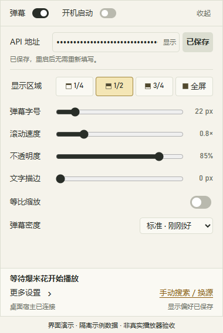
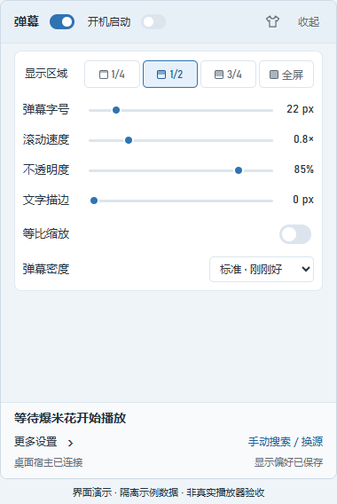
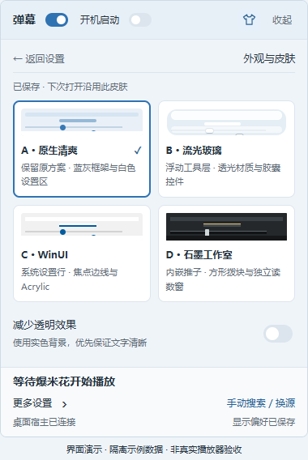
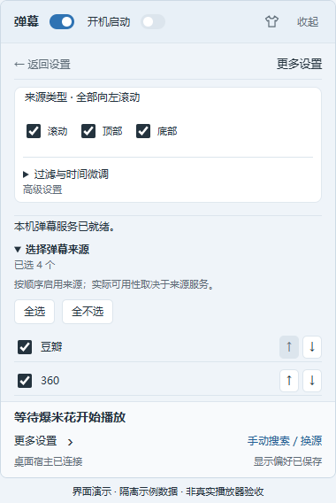
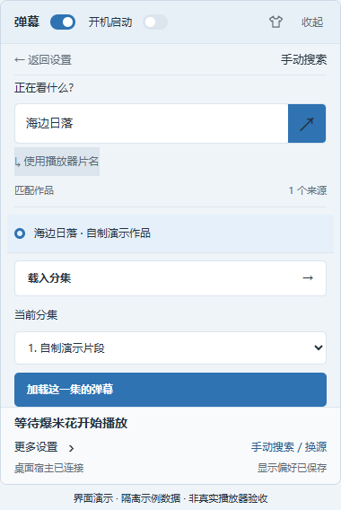
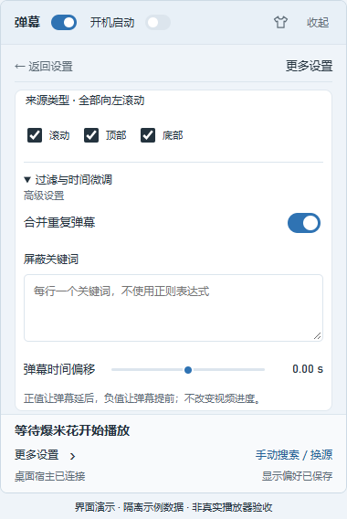

# 爆米花弹幕伴侣


给 **网易爆米花 Windows 播放器**加上弹幕。

打开视频后，伴侣会识别片名和集数，自动寻找弹幕并跟随播放进度。平时留在系统托盘，点击图标就能调整设置，用完收起，继续看视频。

它是配合播放器使用的小工具，不提供影视资源。获取弹幕需要联网。

**[下载 Beta6](https://github.com/ghjkllasdf-fake/Baomihua-danmu-companion/releases/tag/v0.1.1-beta.6)** · [版本更新](CHANGELOG.md) · [反馈问题](https://github.com/ghjkllasdf-fake/Baomihua-danmu-companion/issues)

**Beta6 更新**：更新应用、托盘和浏览器图标；修复直接选集识季、大幅跳转后弹幕反复入场的问题，加入四套皮肤和来源批量选择。详见 [更新记录](CHANGELOG.md)。

**2026-10-30 图标补发**：版本号仍为 `0.1.1-beta.6`，安装包和 Portable 已重新构建。已下载早期 Beta6 的用户，请退出旧版后重新下载；Portable 请解压到新文件夹。

## 能做什么

- **自动找弹幕**：识别当前作品和集数，加载弹幕；同一部剧换集时优先沿用已选来源。
- **多季剧分别匹配**：核对当前季数后搜索，兼容“第二季”“第2季”“S02E02”等写法；不同季分别绑定来源，其他季的弹幕不会因为数量更多而被选中。
- **跟随视频播放**：响应播放、暂停和进度跳转。弹幕只显示在视频窗口上，视频最小化后一起隐藏，其他窗口也能盖住它。
- **随手调整显示**：区域、字号、速度、不透明度、描边、缩放和密度都在托盘面板里。
- **四套外观可选**：原生清爽、流光玻璃、WinUI、石墨工作室，选择后下次启动继续使用。
- **手动搜索、换源**：自动匹配不合适时，自己选择作品、来源和分集。
- **过滤和校时**：屏蔽关键词、合并重复弹幕，调整时间偏移；也可以按需开启 Windows 开机启动。

## 下载与安装

适用于 **Windows 10 2004 或更新版本、Windows 11 的 x64 电脑**。请先安装网易爆米花播放器。

### 选哪个版本？

**没有自己的弹幕服务，选 includeAPI 安装版。** 它会自动启动包内的本机服务，无需填写地址。已有可用弹幕 API 的用户可以选普通版，文件更小。

本文对应 `0.1.1-beta.6`：

| 版本 | 适合谁 | 安装包 | 免安装包 |
|---|---|---|---|
| includeAPI 版 | 想直接使用，不自行部署服务 | [下载安装版](https://github.com/ghjkllasdf-fake/Baomihua-danmu-companion/releases/download/v0.1.1-beta.6/DanmuCompanion-0.1.1-beta.6-win-x64-includeAPI-setup.exe) | [下载 Portable](https://github.com/ghjkllasdf-fake/Baomihua-danmu-companion/releases/download/v0.1.1-beta.6/DanmuCompanion-0.1.1-beta.6-win-x64-includeAPI-portable.zip) |
| 普通版 | 已有兼容的弹幕 API 地址 | [下载安装版](https://github.com/ghjkllasdf-fake/Baomihua-danmu-companion/releases/download/v0.1.1-beta.6/DanmuCompanion-0.1.1-beta.6-win-x64-setup.exe) | [下载 Portable](https://github.com/ghjkllasdf-fake/Baomihua-danmu-companion/releases/download/v0.1.1-beta.6/DanmuCompanion-0.1.1-beta.6-win-x64-portable.zip) |

- **安装版**：运行下载的安装包，按提示完成安装，再从开始菜单打开“爆米花弹幕伴侣”或“爆米花弹幕伴侣 includeAPI”。默认安装到当前用户目录。
- **Portable 版**：把 ZIP **完整解压**到本地可写文件夹，再运行其中的 `DanmuCompanion.exe`。请保留整个文件夹，不要只复制 EXE，也不要在压缩软件里直接运行。

程序使用系统的 **Microsoft WebView2 Evergreen Runtime（124 或更新版本）**。缺少时，安装版会联网补装；Portable 用户请先运行包内的 `MicrosoftEdgeWebview2Setup.exe`。其他运行环境已随包提供，无需另装 .NET、Node 或 PowerShell。

本版程序和安装包尚未进行代码签名，Windows 可能提示未知发布者。请从上面的 Release 页面下载，可用随附的 `SHA256SUMS.txt` 检查文件完整性；无需关闭杀毒软件。

## 开始使用

1. **打开托盘面板。** 启动后程序会留在系统托盘，点击图标展开。找不到图标时，展开任务栏的“显示隐藏的图标”。
2. **连接弹幕服务。** includeAPI 版等待本机服务就绪即可；普通版在首行填入“API 地址”，点击“保存地址”。
3. **在爆米花里播放视频。** 伴侣会自动识别、匹配并加载弹幕，面板底部可以查看当前作品、来源和弹幕数量。

搜索和装载进度会显示在视频右上角，首条弹幕出现后提示渐隐。遇到临时网络问题或没有搜索结果时，自动匹配最多尝试三轮；仍未找到会提示手动搜索，视频上的失败提示在五秒后消失。

最终匹配失败时，面板底部的“手动搜索 / 换源”会突出显示“需处理”。点击后可以自行搜索；切换作品或开始处理后，提示恢复普通状态。

### 普通版：填写 API 地址

普通版需要兼容 **弹弹play API v2** 的服务，例如自行部署的 [danmu_api](https://github.com/huangxd-/danmu_api)。不知道该填什么时，使用 includeAPI 版更方便。

填写服务提供的完整地址；如果带有路径 Token，也一起填入。例如：

```text
https://danmu.example.com
https://danmu.example.com/YOUR_TOKEN/api/v2
```

请填服务地址，而不是管理后台登录页。当前支持直接访问和路径 Token，不支持依赖网页登录、Cookie、查询参数 Token 或额外鉴权请求头的服务。

修改地址后点击“保存地址”才会生效，重启后会继续使用。要删除地址，清空输入框后点击“清除保存”。

### 调整弹幕

日常设置都在主面板里，没有单独的预览窗口。

| 普通版 | includeAPI 版 |
|---|---|
|  |  |

*界面截图使用示例数据。*

| 设置 | 用法 |
|---|---|
| 弹幕开关 | 左上角一键显示或隐藏弹幕。 |
| 显示区域 | `1/4`、`1/2`、`3/4`、全屏，表示从视频顶部向下的显示范围。 |
| 字号、速度、不透明度、描边 | 直接拖动对应滑块。 |
| 等比缩放 | 让弹幕大小随视频窗口一起缩放。 |
| 弹幕密度 | 在稀疏、标准、密集之间选择。 |
| 更多设置 | 调整来源类型、重复弹幕合并、屏蔽关键词和时间偏移；includeAPI 版也在这里选择弹幕来源。 |

首次使用默认字号为 22 px、速度为 0.8×、不透明度为 85%、描边为 0 px，等比缩放关闭。设置会自动保存。

### 更换皮肤与选择内置来源

点击右上角的 **衣服图标**，选择原生清爽、流光玻璃、WinUI 或石墨工作室。外观会自动保存；流光玻璃的透明效果取决于 Windows 支持和系统设置，也可以开启“减少透明效果”使用实色底。

includeAPI 版在“更多设置 → 选择弹幕来源”中调整来源。可以“全选”“全不选”或逐项勾选、上移排序，最后点击 **“应用来源”**。至少保留一个来源；勾选更多来源不代表每个来源都能返回结果，也可能增加等待时间。

| 外观与皮肤 | includeAPI 来源选择 |
|---|---|
|  |  |

*界面截图为当前 React 界面配隔离示例数据；玻璃皮肤的实际桌面透色不能由浏览器截图展示。*

### 观看效果


*视频画面为本项目自制演示素材，弹幕使用生产原生渲染器绘制并叠合展示；此图不作为真实播放器、性能或多屏验收证据。*

### 手动搜索或换源

1. 点击面板底部的 **“手动搜索 / 换源”**。
2. 输入片名，点击搜索按钮；也可以选择“使用播放器片名”。搜不到时，试试作品原名或去掉年份。
3. 选中正确的作品和来源，点击 **“载入分集”**。
4. 确认当前分集，点击 **“加载这一集的弹幕”**。

手动选择后，当前视频使用你选的弹幕；切换视频时恢复自动匹配。弹幕时间不合适时，先确认来源和集数，再到“更多设置 → 过滤与时间微调”调整偏移：**正值让弹幕晚出现，负值让弹幕早出现**。

<details>
<summary>查看手动搜索和更多设置</summary>

| 手动搜索与分集选择 | 更多设置 |
|---|---|
|  |  |

</details>

### 收起、退出与开机启动

再次点击托盘图标、点击面板外部、按 `Esc` 或点“收起”，都只会隐藏面板，弹幕仍随视频播放。要完全退出，请右键托盘图标，选择 **“退出弹幕伴侣”**。

左上角的 **“开机启动”** 默认关闭。开启后，下次登录 Windows 时程序会自动驻留托盘。面板会根据任务栏的位置，从相应方向滑出。

## 升级与卸载

升级或切换普通版／includeAPI 版前，先从托盘退出旧程序，两版不要同时运行。

- **安装版升级**：退出后安装到原目录；若要更换安装位置，先卸载旧版，再安装新版。
- **Portable 升级**：把新版解压到新文件夹运行，避免混合不同版本的文件。
- **卸载**：安装版在 Windows“已安装的应用”中卸载；Portable 退出后删除程序文件夹。

如果开启了“开机启动”，更换或删除程序文件夹前先关闭，再按需在新位置开启。

两版共用当前 Windows 用户的显示设置，普通版保存的 API 地址也会保留。卸载默认保留个人配置。从旧脚本版或 beta.1 迁移，以及彻底清除数据的方法，见 [安装与升级说明](docs/BETA-USER-GUIDE.md)。

## 遇到问题怎么办

| 现象 | 可以这样处理 |
|---|---|
| 启动后没看到窗口 | 程序默认驻留托盘。点击托盘图标，也检查一下“显示隐藏的图标”。 |
| 提示缺少 WebView2、版本过旧，或面板白屏 | 运行包内 `MicrosoftEdgeWebview2Setup.exe` 联网安装／更新，退出程序后重新打开。 |
| 提示应用文件缺失或文件检查失败 | 重新下载安装包，或把完整 ZIP 解压到新文件夹，不要只复制主 EXE。 |
| 一直显示等待爆米花播放 | 在爆米花中打开实际的视频窗口。仍无法识别时，请反馈播放器版本和当时的播放界面。 |
| 搜不到弹幕，或自动选错作品 | 使用“手动搜索 / 换源”，尝试原名、简称或去掉年份，再核对作品和分集；也可以换一个来源。 |
| 普通版提示连接或认证失败 | 检查 API 地址是否完整、修改后是否已保存，以及 Token 是否有效。显示“已保存”后仍需服务本身可访问。 |
| includeAPI 提示本机服务未就绪 | 打开“更多设置 → 选择弹幕来源”，点击“重试启动”；若更改了来源，至少保留一个，再点“应用来源”。 |
| 提示请求过多／HTTP 429 | 等待后再搜索或加载，避免连续换源、反复点击。 |
| 已加载但看不到弹幕 | 确认左上角“弹幕”已开启，视频没有最小化或被遮住；若该来源没有弹幕，换一个来源。 |
| 弹幕比画面早或晚 | 先核对来源、版本和集数，再调时间偏移。若无法读取播放时间，可在“更多设置 → 手动时间校准”中输入视频当前时间。 |
| 视频最小化或被其他窗口挡住后，弹幕也不见了 | 这是正常行为。恢复或露出视频窗口后，弹幕会跟随显示。 |
| 提示“重新同步设置” | 点击它重新读取设置，再确认需要调整的选项。 |

仍有问题，可以到 [Issues](https://github.com/ghjkllasdf-fake/Baomihua-danmu-companion/issues) 反馈。请写明 **伴侣版本、普通版或 includeAPI、Windows 和播放器版本、操作步骤、提示内容**；有截图更容易定位。发图或日志前，请遮住真实 API 地址、Token 和个人信息。安全漏洞请按 [安全问题反馈说明](SECURITY.md) 联系。

## 数据与隐私

- 普通版的 API 地址使用当前 Windows 用户的加密保护，保存在 `%LOCALAPPDATA%\BaomihuaDanmuCompanion\api.dat`。换电脑或 Windows 账户后需要重新填写。
- 显示设置保存在 `%LOCALAPPDATA%\BaomihuaDanmuCompanion\app\preferences.json`，普通版和 includeAPI 版共用。
- 搜索片名和获取弹幕的请求会发送到你配置的服务，或 includeAPI 中启用的来源。本机服务也需要联网获取弹幕，请使用自己信任的服务。
- 为补足播放窗口省略的季数，伴侣会只读核对爆米花已有的首页缓存或详情页中的当前季、集、文件名和时长。不会修改播放器缓存，不解析凭据端点、不解密数据库，也不上传文件路径或缓存。信息不足或冲突时会提示处理，不默认猜第一季。

## 更多说明

[安装、升级与卸载](docs/BETA-USER-GUIDE.md) · [includeAPI 使用指南](docs/INCLUDEAPI-USER-GUIDE.md) · [源码构建说明](docs/DEVELOPMENT.md)

## 开发与历史版本

当前主线使用原生 .NET 程序，构建入口和测试命令见 [源码构建说明](docs/DEVELOPMENT.md)。旧 PowerShell 预览版的 BAT、启动和打包流程已从主线移除，历史实现仍可在对应 Git 标签查看。源码清理不会替换已经发布的 Beta6 安装包。

## 开源与许可

原创桌面客户端、图标与自制演示素材采用 [MIT License](LICENSE)。includeAPI 内的上游程序、本机适配器和补丁采用 AGPL-3.0，同版本 Release 提供 `corresponding-source.zip` 对应源码。其他组件的许可见 [第三方依赖说明](docs/THIRD-PARTY-NOTICES.md)。

本项目与网易爆米花、弹弹play及相关弹幕服务没有官方隶属关系。
