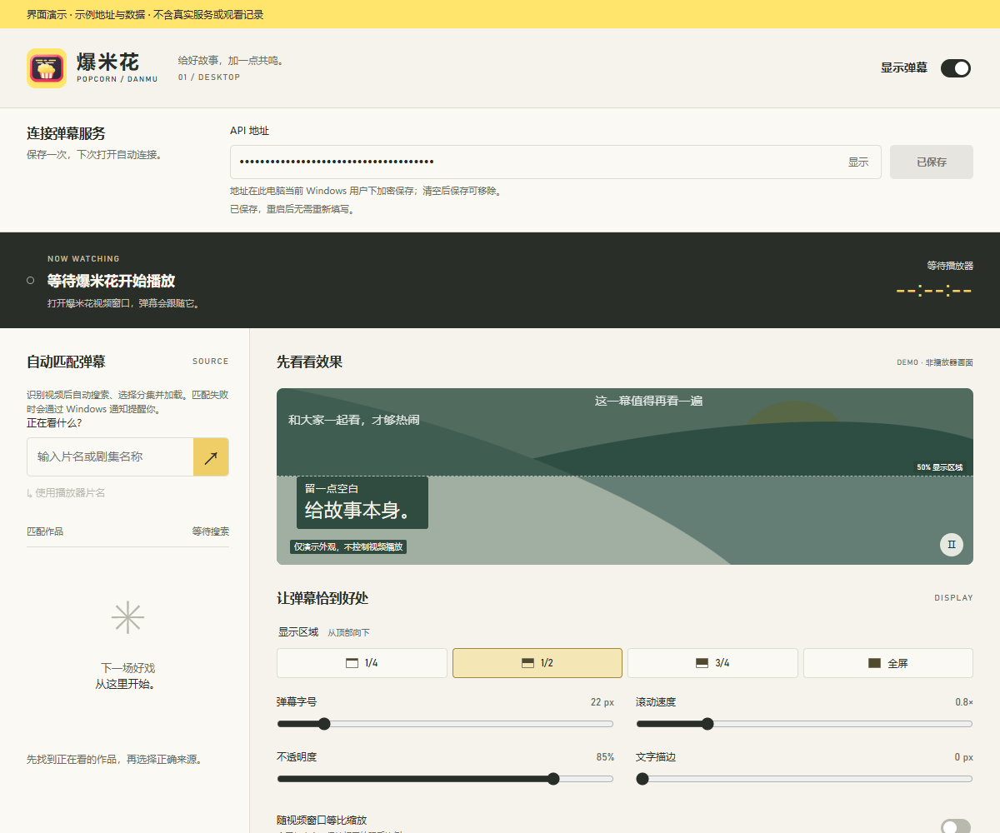
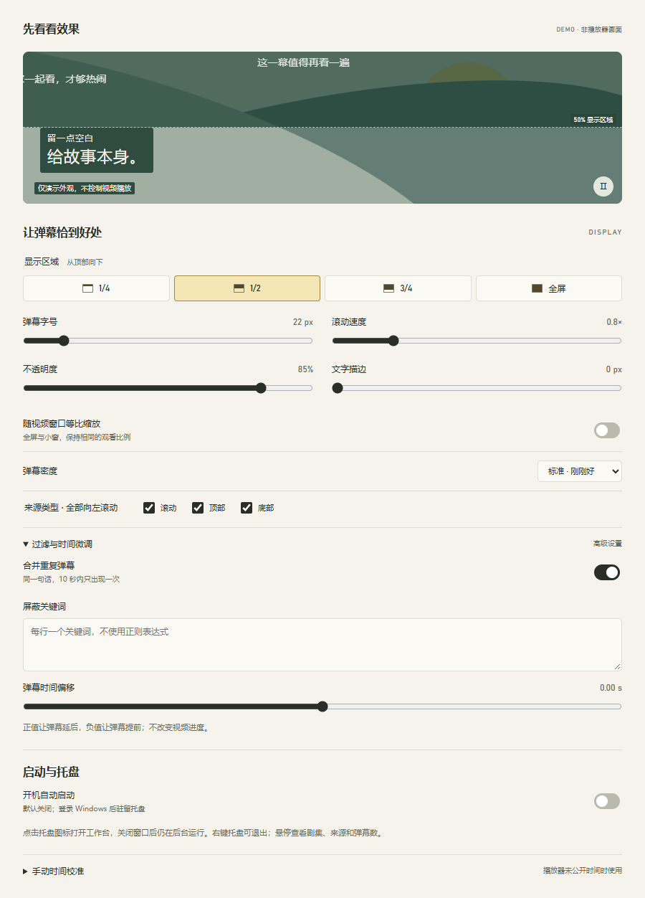
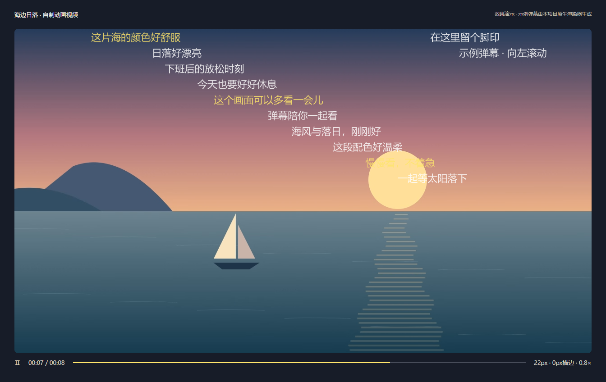

# 爆米花弹幕伴侣


给 **网易爆米花 Windows 播放器**加上弹幕。

填入你自己的弹幕 API 服务地址后，助手会识别正在播放的作品和集数，自动寻找弹幕、跟随播放进度，并把弹幕显示在视频窗口上。

**当前 Beta：`0.1.0-beta.2`，Windows x64，约 200 MiB 的原生 EXE 安装版与 Portable 版。**

功能基线为 `v0.1.0-preview.15`，Beta 改用原生 EXE 和系统共享 WebView2；不要与旧脚本版或完整离线版混合覆盖。“约 200 MiB”指安装／解压后的程序文件，不是压缩下载包。

➡️ **[查看已发布版本](https://github.com/ghjkllasdf-fake/Baomihua-danmu-companion/releases)**

Beta 安装包为 `DanmuCompanion-0.1.0-beta.2-win-x64-setup.exe`，免安装包为 `DanmuCompanion-0.1.0-beta.2-win-x64-portable.zip`。普通用户不应下载 GitHub 自动生成的 **Source code** 压缩包；源码包不包含运行依赖。

本开发分支新增 `0.1.0-beta.3 includeAPI` 本地候选：内置仅回环监听的后台 API，自动连接，只开放来源设置；每轮最多抽样 3 个候选来源。它是体积更大的独立变体，尚不表示已发布或替换 beta.2。说明见 [includeAPI 使用指南](docs/INCLUDEAPI-USER-GUIDE.md)；下文的外部 API 填写和全来源比较描述仍针对已发布的普通版。

## 界面与效果预览

以下三张图供了解操作和外观。设置界面使用示例地址与演示数据，API 默认隐藏；不包含真实服务、账号或观看记录。

**工作台与 API 保存**：地址放在顶部，修改后点击“保存地址”；成功后显示灰色“已保存”。



**显示与启动设置**：区域、字号、速度、描边、过滤、时间偏移和默认关闭的开机启动。



**视频弹幕效果示意**：自制动画视频画面与本项目原生渲染器输出的示例弹幕按1:1叠合。不使用私人影视截图，也不把演示图当作真实播放器识别的验收证明。



## 能做什么

- **自动匹配当前集**：识别片名、集数，自动搜索并加载弹幕，不需要每集手动选取。
- **优先选择弹幕多的来源**：首次比较当前集所有匹配来源的实际可用弹幕数，选择最多的一个。
- **同剧保持同一来源**：后续集数沿用已选来源；遇到缺集、零弹幕或来源不可用，才为当前集重新择优，并在后续沿用新来源。
- **跟随播放**：响应播放、暂停和进度跳转；跳转时清除旧画面，防止旧弹幕反向闪现。
- **切换窗口也能看**：视频窗口仍显示时，点击其他窗口不会隐藏弹幕；播放器最小化、隐藏或关闭时隐藏。
- **统一向左滚动**：各种来源类型都从右侧进入，向左滚动。
- **显示设置**：区域、字号、速度、透明度、描边、密度、关键词屏蔽、去重和时间偏移。
- **托盘常驻**：启动后先驻留 Windows 托盘，点击图标才打开工作台；悬停查看当前剧集、弹幕来源和数量。
- **可选开机启动**：在工作台的“启动与托盘”中开启，默认关闭。
- **API 保存一次即可**：顶部保存服务地址，退出、重启及升级到新文件夹后自动读取；修改后再保存才生效。
- **失败时再打扰**：自动处理失败才发 Windows 通知，点击通知可返回工作台手动处理。

## 使用前需要准备

| 需要什么 | 说明 |
|---|---|
| Windows x64 电脑 | Windows 10 2004（19041）或更新版本、Windows 11；实际验收见 Beta 验证报告，ARM64 未验证。 |
| 网易爆米花 | 由你自行安装。助手不包含播放器、影视资源或下载功能。 |
| 本地可写文件夹 | 安装或完整解压 Beta；不支持网络共享及映射网络盘。 |
| WebView2 Evergreen Runtime | 系统稳定版 124 或更新版本；已有则复用，没有时运行包内微软联网引导程序。 |
| 弹幕 API 服务 | **必须自行准备可用的服务地址**，详见下节。 |

Beta 内置自包含 .NET，主程序、播放器采样和开机启动直接使用 EXE，**不需要 PowerShell、Node、npm 或另装 .NET**。WebView2 使用系统共享版本：安装器缺少时会联网补装；Portable 缺少时请先运行同目录 `MicrosoftEdgeWebview2Setup.exe`。应用默认按当前用户安装，不要求提权；不能只复制一个 EXE。

## API 依赖：没有服务地址就不能下载弹幕

本项目是弹幕客户端，**不附带弹幕库、公共 API、服务账号或 Token**，也不会替你部署后端。

需要一个兼容 **弹弹play API v2** 的弹幕服务，例如自行部署的 [danmu_api](https://github.com/huangxd-/danmu_api)。具体部署、数据源、访问权限和 Token 配置请按该服务的文档处理。

地址示例（仅为格式示意）：

```text
https://danmu.example.com
https://danmu.example.com/YOUR_TOKEN
https://danmu.example.com/YOUR_TOKEN/api/v2
```

应用会按服务地址调用：

```text
GET /api/v2/search/anime?keyword=片名
GET /api/v2/bangumi/作品ID
GET /api/v2/comment/分集ID?format=json&duration=true
```

如果服务使用路径前缀或路径 Token，把它一起填入地址。不要填管理后台登录页，也不要使用 `?token=…`、网址中的用户名密码或片段参数。末尾已有 `/api/v2` 时无需手动删掉，助手会处理。

当前支持直接访问或路径 Token，不支持依赖网页登录、Cookie 或额外鉴权请求头的服务。

局域网服务可使用 HTTP；通过互联网访问时建议使用 HTTPS。你输入的搜索片名和分集请求会发往这个服务，请使用自己信任的服务。

## 三步开始观看

1. 运行 Beta 的 `setup.exe` 并选择安装目录，或者完整解压 `portable.zip` 到本地可写文件夹。不要覆盖无关文件、正在运行的旧目录或混用两版运行库。
2. 从开始菜单打开“爆米花弹幕伴侣”，或双击 Portable 内的 **`DanmuCompanion.exe`**。程序先进入托盘，点击任务栏右侧的图标打开工作台；图标可能收在“显示隐藏的图标”内。
3. 在工作台顶部“连接弹幕服务”中填入完整 API 地址，点击 **“保存地址”**，然后在爆米花中打开视频。识别成功后会自动匹配、选集和加载，工作台会显示来源和弹幕数量。

地址保存成功后，按钮为灰色“已保存”，重启后无需重新填写。输入或修改地址后按钮重新可用；未点击保存的修改不会影响当前服务。“已保存”只表示本地保存成功，服务是否可用仍以实际匹配结果为准。清空输入框后点击“清除保存”可以删除保存记录并断开当前服务。

API 使用 Windows 当前用户的数据保护功能加密，独立保存在 `%LOCALAPPDATA%\BaomihuaDanmuCompanion\api.dat`，不使用浏览器存储，不写入显示偏好。升级到新文件夹仍可读取；复制到其他电脑或 Windows 账户不能直接解密，需要重新填写。显式配置 `DANMU_API_BASE` 环境变量时，以它作为本次启动地址，原保存值保留，直到再次点击保存。

关闭工作台只收回托盘；右键托盘选择“退出弹幕伴侣”才会退出。来源绑定只保留在本次运行中，重启后会为当前集重新匹配。

如果自动匹配失败，点击 Windows 通知返回工作台，手动搜索、换源或重试即可。手动操作后当前视频由你接管，下次切换视频恢复自动匹配。Windows 免打扰可能隐藏通知，工作台仍会保留失败提示。

## 怎样调弹幕

- 首次启动默认：**字号 22 px、描边 0 px、滚动速度 0.8×、关闭等比缩放**。已有显示偏好会继续使用，不强制覆盖。
- **1/4、1/2、3/4、全屏**：从视频顶部向下的显示范围。
- **来源类型**：决定是否包含原滚动、顶部和底部来源；它们最终都会向左滚动。
- **时间偏移**：正值让弹幕晚出现，负值让弹幕早出现。先确认来源和集数正确，再做小幅调整。
- 工作台里的风景是标注过的**样式演示**，不是播放器画面；真正弹幕由独立透明覆盖层显示。
- Beta 设置保存在 `%LOCALAPPDATA%\BaomihuaDanmuCompanion\app\preferences.json`，不含 API 地址和 Token。出现“重新同步设置”时，先点击它核对实际保存结果。

安装、升级、旧版偏好迁移和卸载说明见 [Beta 使用指南](docs/BETA-USER-GUIDE.md)。旧预览版文档仅用于历史版本。

## 开机启动与托盘

在“启动与托盘”中打开“开机自动启动”，下次登录 Windows 后程序会驻留托盘，不会弹出工作台。这个选项默认关闭，无需管理员权限；关闭选项会移除本程序的启动快捷方式。

点击托盘图标打开工作台，右键可打开或退出。鼠标悬停可查看当前剧集、弹幕来源和弹幕数；较长的名称会截短，完整来源仍可在工作台查看。

开机启动会自动读取你已保存的 API 地址。移动、删除文件夹或更换版本前，先关闭旧版的开机启动，再在新文件夹中重新开启；若在 Windows 启动应用设置中禁用了本程序，也需要在系统中恢复。

如果 preview.15 曾开启脚本式自启动，Beta 会识别这条精确匹配的旧快捷方式。请在 Beta 中先关闭开机启动，再按需开启，即可改为直接 EXE 启动；不会自动替未开启过的用户启用。卸载器只移除指向本次安装的原生启动项，不移除旧版或其他目录的启动项。

## 遇到问题

| 现象 | 先检查什么 |
|---|---|
| 提示缺少 WebView2 或版本过旧 | 运行包内微软 `MicrosoftEdgeWebview2Setup.exe` 联网安装／更新后重试；不要混入旧版私有浏览器。 |
| 提示应用文件缺失 | 重新完整解压或安装同版 Beta，不要只复制主 EXE。 |
| 没有识别出视频 | 打开爆米花的实际视频窗口。播放器版本、窗口标题或可访问性信息变化可能影响识别。 |
| 匹配失败、没有弹幕 | 检查 API 地址和服务是否可用；该作品或分集也可能确实没有弹幕。可手动换源。 |
| 弹幕不同步 | 先确认分集和版本，再调整时间偏移。播放信息读不到时不会假装已经自动同步。 |
| 点击其他窗口后看不到弹幕 | 请确认使用的是新版、视频没有最小化，并且“显示弹幕”开关已开启。 |
| 文件检查失败 | 重新解压完整 ZIP 到新文件夹。校验用于发现文件缺失或损坏，不是数字签名。 |
| 想升级 | 先从托盘退出旧版，再把新版解压到新文件夹运行。若启用过开机启动，请先关闭旧版的该选项。保留旧文件夹便于回退。 |
| 启动后没有主窗口 | 新版默认驻留托盘，点击任务栏右侧图标打开；也请检查“显示隐藏的图标”。 |
| 从托盘打开后白屏 | 请更新到 preview.13 或之后的版本，已修复后台启动后界面显示状态未恢复的问题。 |

反馈时请写明版本、播放器版本、刚才的操作和实际现象。**不要公开真实 API 地址、Token、完整运行缓存或未遮挡的敏感截图。**

## 预览版的边界

这是供实际观看、收集反馈的预览版，不是已完成全部验收的稳定版。

- 读不到播放器信息时，需要等待恢复或手动处理；不能保证所有爆米花版本都可识别。
- 当前覆盖层按播放器客户区定位，可能包含黑边。
- 暂停/继续或首次调整设置可能有短暂延迟。
- 多屏 DPI、长时间观看、连续拖动以及不同剧集/电影组合仍需更多使用验证。

## 安全与隐私

- 公开源码和 Release 不包含开发机器的真实 API 默认值、个人目录、观看记录或运行缓存。
- API 在点击保存后使用 Windows 当前用户 DPAPI 加密保存；不写入显示偏好、浏览器 localStorage 或 sessionStorage。界面默认隐藏地址，关闭 WebView2 表单自动填充和密码保存。相同 Windows 用户下运行的程序仍属于同一信任范围；加密不能替代操作系统账户保护。
- 不在普通使用中开放调试端口；本地界面不能任意执行脚本、读取路径或启动进程。
- 项目没有加入遥测或上传截图功能。诊断与测试可能生成本机日志，分享前仍需自行脱敏。
- [本次发布审查说明](docs/SECURITY-AUDIT.md) · [安全问题反馈](SECURITY.md)

## 源码与开发

源码构建、固定依赖版本和测试命令见 [开发说明](docs/DEVELOPMENT.md)。

## 开源许可证

本项目原创代码、图标与自制演示素材采用 [MIT License](LICENSE)：允许使用、修改、分发及商业使用，分发时保留版权和许可声明；按许可原文不提供担保。选择 MIT 是为了让这个桌面工具便于复用和接受贡献，不要求修改版公开源码。

第三方组件继续遵循各自的许可，见 [第三方依赖说明](docs/THIRD-PARTY-NOTICES.md)；MIT 不替代这些条款，也不授予网易爆米花等第三方品牌、影视或弹幕内容的权利。本项目与网易爆米花、弹弹play及相关弹幕服务均无官方隶属关系。
