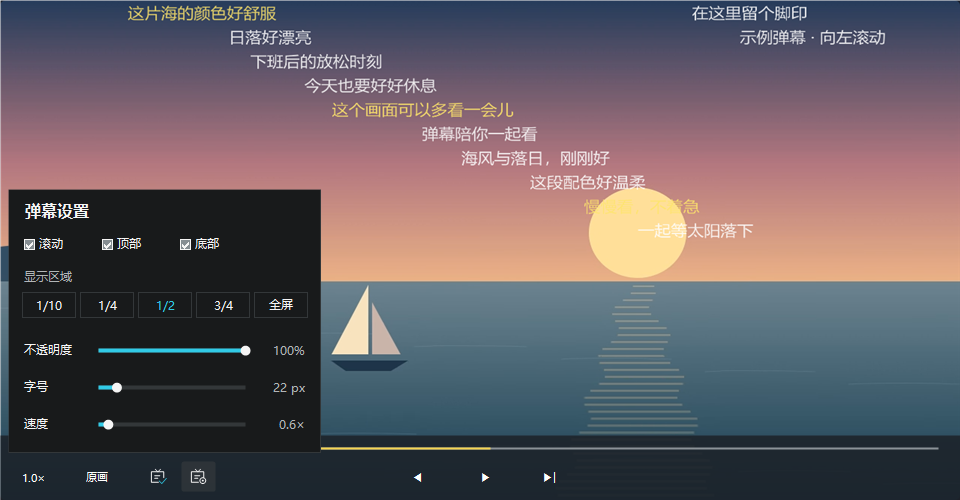
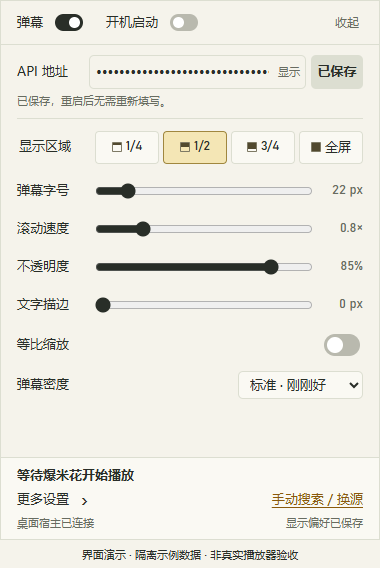
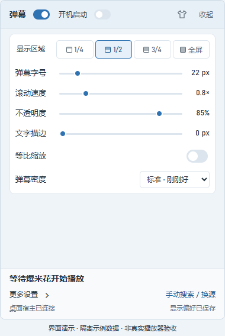
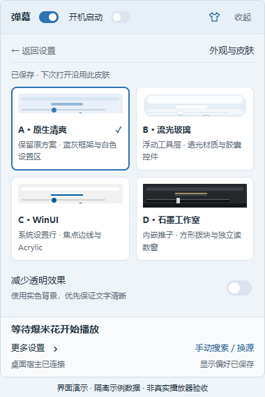
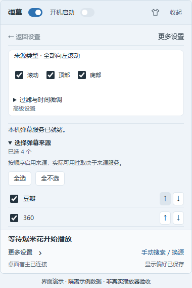
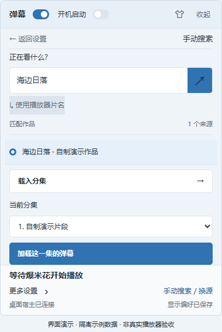
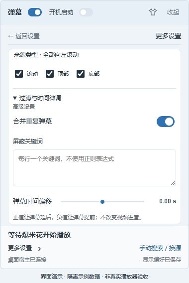

# 爆米花弹幕伴侣

给 **网易爆米花 Windows 播放器**加上弹幕。打开视频后，伴侣会尝试自动寻找对应弹幕，让弹幕跟随播放进度；平时收在系统托盘，想调整时再打开。

本项目不提供电影、电视剧或播放器；获取弹幕需要联网。

**[下载 0.2.4 正式版](https://github.com/ghjkllasdf-fake/Baomihua-danmu-companion/releases/tag/v0.2.4)** · [更新记录](CHANGELOG.md) · [遇到问题](https://github.com/ghjkllasdf-fake/Baomihua-danmu-companion/issues)

## 它能做什么

- **自动找弹幕**：尝试识别片名和集数，同一部剧换集时优先使用之前选择的来源；找错时可以手动搜索或换源。
- **跟随视频播放**：响应播放、暂停和进度跳转。弹幕只显示在视频窗口上；视频被遮挡或最小化时，弹幕也会被遮挡或隐藏。
- **边看边调整**：设置弹幕区域、字号、速度、透明度、描边、阴影、密度和类型，也能屏蔽关键词、合并重复弹幕或微调时间。
- **轻量面板**：程序驻留系统托盘，支持四种外观、开机启动和新版提醒。

### 播放器上的快捷按钮

在兼容的爆米花播放窗口中，显示播放器控制栏时，会出现两个弹幕按钮：点击左侧按钮开关弹幕；将鼠标移到右侧按钮，可以打开快捷设置。

*示意图由项目自制画面和 0.2.4 原生控件合成，并非真实播放器截图。按钮只在能够识别控制栏位置和状态时出现；未出现时，仍可使用托盘面板。*

## 下载与安装

支持 **Windows 10 2004 或更新版本、Windows 11 的 x64 电脑**。请先安装网易爆米花播放器。

| 版本 | 适合谁 | 安装版 | 免安装版 |
|---|---|---|---|
| **内置服务版（includeAPI）** | 不想自己准备弹幕服务；推荐第一次使用 | [下载安装版](https://github.com/ghjkllasdf-fake/Baomihua-danmu-companion/releases/download/v0.2.4/DanmuCompanion-0.2.4-win-x64-includeAPI-setup.exe) | [下载免安装版](https://github.com/ghjkllasdf-fake/Baomihua-danmu-companion/releases/download/v0.2.4/DanmuCompanion-0.2.4-win-x64-includeAPI-portable.zip) |
| **普通版** | 已有兼容的弹幕服务地址 | [下载安装版](https://github.com/ghjkllasdf-fake/Baomihua-danmu-companion/releases/download/v0.2.4/DanmuCompanion-0.2.4-win-x64-setup.exe) | [下载免安装版](https://github.com/ghjkllasdf-fake/Baomihua-danmu-companion/releases/download/v0.2.4/DanmuCompanion-0.2.4-win-x64-portable.zip) |

其他附件：[对应源码](https://github.com/ghjkllasdf-fake/Baomihua-danmu-companion/releases/download/v0.2.4/DanmuCompanion-0.2.4-corresponding-source.zip) · [文件校验值](https://github.com/ghjkllasdf-fake/Baomihua-danmu-companion/releases/download/v0.2.4/SHA256SUMS.txt)。

- **安装版**：运行安装包，按提示完成安装，再从开始菜单打开伴侣。
- **免安装版（Portable）**：把压缩包完整解压到本地文件夹，再运行 `DanmuCompanion.exe`。不要直接在压缩包中运行或只复制一个程序文件。

程序需要 Windows 的 WebView2 运行环境。缺少时，安装版会联网安装；免安装版请先运行包内的 `MicrosoftEdgeWebview2Setup.exe`。不需要另装 .NET 或 Node。

程序和安装包尚未签名，Windows 可能提示未知发布者。请从本项目发布页下载；需要时可用 `SHA256SUMS.txt` 核对文件，无需关闭杀毒软件。

## 开始使用

1. 打开伴侣，点击系统托盘中的图标展开面板；找不到图标时，先展开任务栏的隐藏图标。
2. 内置服务版等待服务就绪即可；普通版需要填写并保存自己的弹幕服务地址。
3. 在爆米花中播放视频，等待伴侣搜索并加载弹幕。需要时调整面板里的显示设置。

如果没找到弹幕或选错作品，点击面板底部的 **“手动搜索 / 换源”**，选择作品、来源和分集。多季作品无法确认季数时，也可能需要手动选择。

托盘面板的“更多设置”提供过滤、时间微调、弹幕类型和软件更新；内置服务版还可以选择弹幕来源。顶部弹幕固定显示；底部弹幕需选择“全屏”显示区域并启用底部类型。

### 托盘面板

| 普通版 | 内置服务版 |
|---|---|
|  |  |

| 外观与皮肤 | 内置弹幕来源 |
|---|---|
|  |  |

查看手动搜索和更多设置

| 手动搜索与分集选择 | 更多设置 |
|---|---|
|  |  |

*托盘截图使用示例数据；实际显示内容和设置以你的程序为准。玻璃皮肤的透明效果取决于系统设置。*

## 更新与卸载

“更多设置 → 软件更新”可以检查新版本并打开下载页面，程序不会自动下载安装。更新或切换版本前，请从托盘退出旧程序。

- **安装版**：通常安装到原目录；如需更换目录，请先卸载旧版。
- **免安装版**：完整解压到新文件夹，避免新旧文件混在一起。
- **卸载**：安装版在 Windows“已安装的应用”中卸载；免安装版退出后删除程序文件夹。个人设置默认保留。

详细步骤：[普通版指南](docs/BETA-USER-GUIDE.md) · [内置服务版指南](docs/INCLUDEAPI-USER-GUIDE.md)。

## 常见问题

| 现象 | 试试这样做 |
|---|---|
| 找不到伴侣窗口 | 点击系统托盘图标，或展开任务栏的隐藏图标。 |
| 播放器里没有快捷按钮 | 部分播放器布局无法识别，改用托盘面板即可；不影响弹幕本身。 |
| 一直等待播放或没有弹幕 | 确认视频已打开、弹幕开关已开启；稍等片刻，或使用“手动搜索 / 换源”。 |
| 弹幕与视频时间不一致 | 先核对作品和分集，再在“更多设置”中调整时间偏移。部分情况下首次同步需要等待，倍速变化也可能不会立即生效。 |
| 提示播放器以管理员身份运行 | 保存并退出播放器，再以普通方式打开；从托盘退出并重启伴侣。不要将程序设置为永久管理员运行。 |
| 字幕菜单无响应 | 可先退出外部自动化或调试工具，再重启播放器。这不是对问题原因的确定结论。 |
| 提示服务未就绪或请求过多 | 检查网络；内置服务版可在“更多设置 → 选择弹幕来源”重试，遇到请求过多请稍后再试。 |

反馈时请写明伴侣版本、所用版本、Windows 和播放器版本，以及复现步骤。分享截图或日志前，请遮住真实服务地址、访问令牌和个人信息；安全问题请参阅 [安全说明](SECURITY.md)。

## 数据、源码与许可

显示设置和普通版保存的服务地址保存在当前 Windows 用户的数据目录。搜索和弹幕请求会发送给你配置的服务，或内置服务版启用的弹幕来源；请使用可信服务。为识别季数，伴侣可能读取播放器已有的首页和最近观看缓存，但不会修改缓存或上传缓存及文件路径。

项目原创客户端采用 [MIT 许可](LICENSE)。内置服务包含独立许可的上游程序及依赖，同版本发布页提供对应源码；详见 [第三方说明](docs/THIRD-PARTY-NOTICES.md) 和 [开发构建](docs/DEVELOPMENT.md)。

本项目与网易爆米花、弹弹play及相关弹幕服务没有官方隶属关系。
