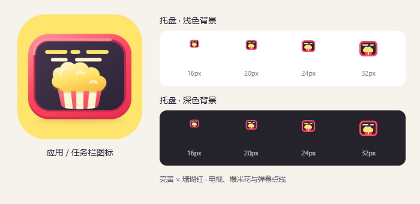
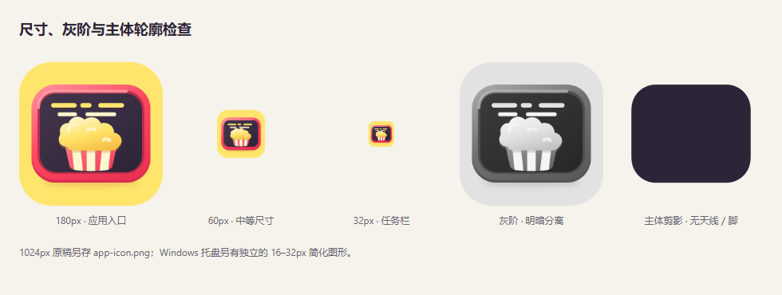

# 图标说明



以用户指定的亮黄和珊瑚红为主色，图形采用本项目自己的电视、爆米花与弹幕构图。preview.14 参考 [design-playful-app-icons](https://github.com/chunkithwang/design-playful-app-icons) 的构图和小尺寸评估方法，放大主体、减少碎线，并统一柔和的立体明暗：

- 没有天线和支撑脚的圆角电视外框表示视频播放。
- 屏幕内的大颗爆米花与条纹桶是唯一辅助物，表达轻松看视频的场景。
- 屏幕上方用少量粗短线表示弹幕；它们与爆米花留出间距，缩小后也不糊成一团。
- 应用图标采用正面、圆润的浅立体造型，光线统一来自左上。黄色底保持安静，厚边框和短阴影体现电视厚度。
- 托盘图标采用同一造型的平面简化版本，去掉高光、阴影、第二排弹幕和细节纹路，保留粗电视框、爆米花和两条弹幕，兼顾 Windows 深浅色任务栏。

| 颜色 | 色值 | 用途 |
|---|---|---|
| 亮黄 | `#FFE56B` | 爆米花和弹幕点线 |
| 珊瑚红 | `#FF4962` | 电视框与爆米花桶 |
| 深紫 | `#2D2438` | 电视屏幕 |
| 奶油白 | `#FFF5D4` | 桶身和小图标点线 |

## 构图与取舍

简报为“电视里的弹幕 + 陪伴观看 + 轻快”。围绕这个需求比较了三个方向，分数是设计自评：

| 方向 | 造型与识别点 | 含义 /20 | 轮廓 /20 | 独创性 /10 | 取舍 |
|---|---|---:|---:|---:|---|
| 圆润影院 | 正面横屏电视，放大的爆米花，浅立体厚边框 | 18 | 16 | 8 | 采用；最直接表达视频和弹幕，适合 Windows 小图标 |
| 爆米花屏幕 | 桶形电视外轮廓，弹幕从桶口上方穿过，平面造型 | 16 | 14 | 9 | 桶形外框容易掩盖“电视”的含义 |
| 斜置随身屏 | 微倾斜窄屏电视，爆米花偏在一侧，软塑料造型 | 17 | 15 | 8 | 小尺寸下内部可用面积较小，倾斜边更容易模糊 |

采用方向属于 skill 的 `soft_3d_object_character` 路线；不添加无关表情。唯一夸张点是屏幕里的大颗爆米花。电视宽度约占画布的83%，所有关键内容位于安全边距内；没有天线、支撑脚、品牌文字或额外挂件。

可复现的构造说明：Windows 方形应用图标，安静的亮黄底；正面珊瑚红圆角电视，占画布宽度约83%，无天线和支撑脚。深紫屏幕上方安排五段粗圆头弹幕线，下方只放一个由大块圆瓣构成的爆米花桶。统一左上光源，用宽倒角、遮挡处明暗和短阴影表现柔和塑料厚度。仅使用黄、红两个色系与深紫／奶油白中性色；不用文字、人物表情、星光、纹理、照片细节或现有品牌图形。32px 时优先保留电视、桶和弹幕线。

## 尺寸检查



按 skill 的七项量表自评：产品含义18/20、轮廓16/20、小尺寸18/20、颜色与对比14/15、风格一致9/10、独创性8/10、平台适配5/5，共88/100。此分数是设计判断，不是用户识别率测量。无天线和脚的电视剪影接近圆角矩形，依靠屏幕内容完成产品含义；因此没有给轮廓满分。

- 1024px 检查边缘、渐变和遮挡；180px 检查整体平衡；60px、32px 保留电视、爆米花桶及弹幕识别点。
- 灰阶中，浅色底／爆米花与深屏幕仍有清楚明暗分离。
- 16–32px 托盘在深浅背景分别查看，16px 不要求保留桶身的全部纹路。

可编辑稿为 [应用 SVG](../assets/app.svg) 和 [托盘 SVG](../assets/tray.svg)。Windows ICO 各包含 16、20、24、32、40、48、64、128、256 px 九个尺寸；工作台和网页图标采用同一份应用 SVG。[应用 PNG](assets/app-icon.png) 为1024px，托盘预览为512px。

本项目交付 Windows 图标：应用圆角外透明、托盘外透明，便于任务栏显示，不套用 iOS 的不透明底或 Android 自适应图标模板。

开发环境安装 UI 固定依赖且已有 Microsoft Edge 后，可在项目根目录运行：

```text
node scripts/Build-Icons.mjs
```

此命令生成 `assets/app.ico`、`assets/tray.ico`、文档预览与尺寸检查 PNG，并同步 `ui/public/favicon.svg`。生成后再构建 UI。普通用户使用 Release 内的现成图标，无需执行此命令。

配色参考入口：`https://bmh.163.com/`。本项目与网易爆米花没有官方隶属关系。
